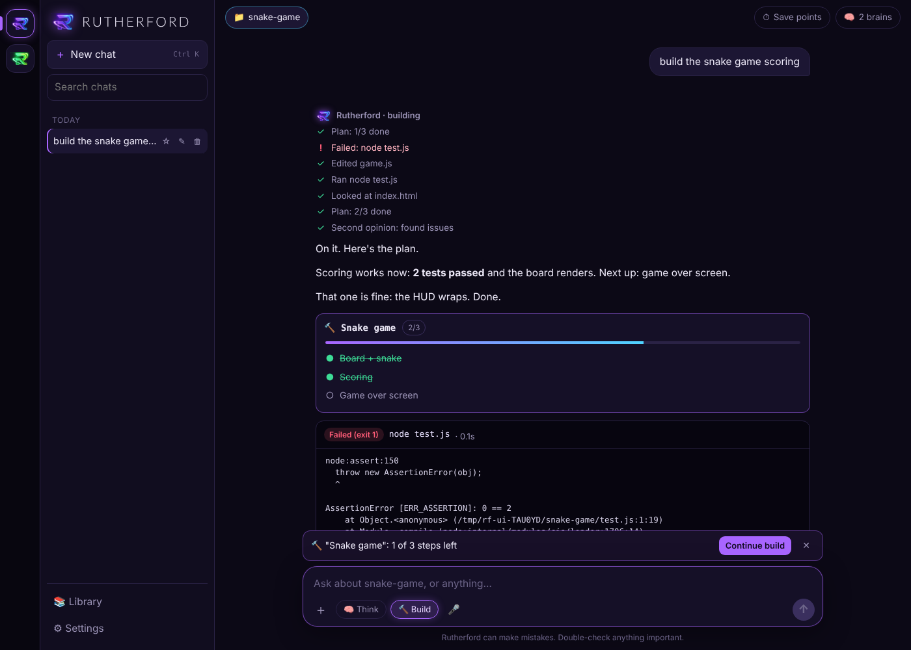
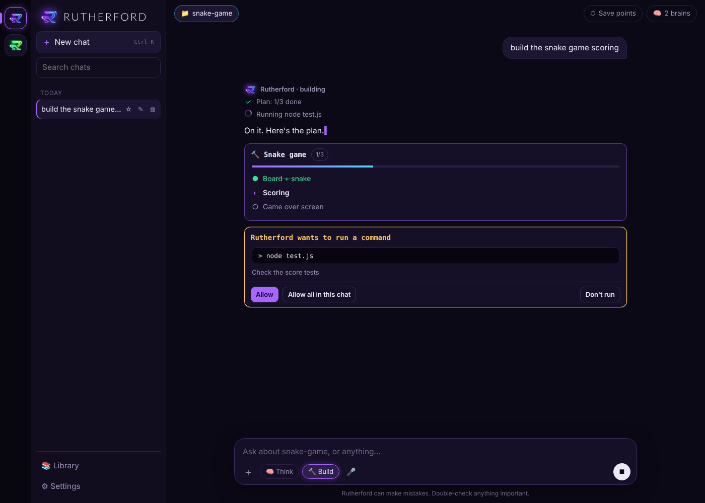
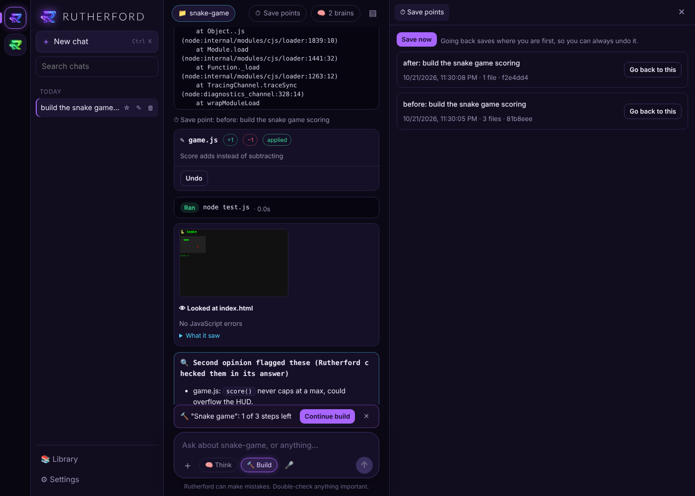
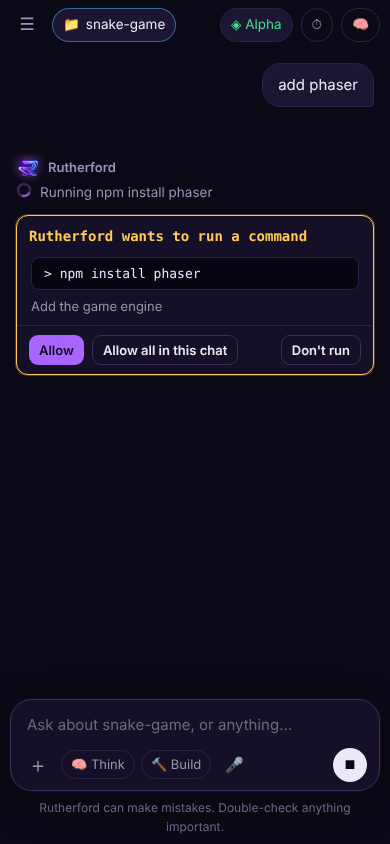

# Rutherford

[](../../actions/workflows/tests.yml)

**A self-hosted AI coding assistant that plans, builds, runs, tests and fixes its own code.** It runs on a regular laptop, uses free AI models, and works from your phone.

Built by **Darren Rutherford**, a self-taught developer and the founder of [TalknTrack](https://talkntrack.live).



## What it does

Most AI chat apps write code and hope it works. Rutherford works like an engineer: it **runs** the code, **reads the real errors**, **fixes** them, and **looks at the result** before it says it's done.

| | |
|---|---|
| 🔨 **Build mode** | Breaks a big job into a checklist, then builds and tests one step at a time. The plan is saved in the project, so a build can pick up later, even in a new chat. |
| ▶ **Run → fix loop** | Runs tests, builds and apps in your project (you approve each command), reads the output and fixes failures until they pass. |
| 👁 **Eyes** | Opens pages and games in a hidden Chrome/Edge (it talks to the browser directly, no extra libraries), clicks and presses keys like a player, screenshots the result and catches JavaScript errors. A vision model describes what's actually on screen. |
| 🔍 **Second opinion** | A *different* AI model reviews every code change for real bugs, and the fixes go back into the same answer. |
| 🧠 **Free-brain chain** | Spreads work across Groq, Google Gemini, NVIDIA and OpenRouter's free tiers. When one hits its rate limit or goes down it switches automatically, and it uses a stronger coding model for project work. |
| 🗺 **Project memory** | A map of every file and its functions, the library versions you have installed, a `RUTHERFORD.md` notes file it follows, and lessons saved from past bugs. |
| ⏱ **Save points** | Automatic Git snapshots before and after changes, and you can go back to any of them (going back can be undone too). `node_modules` and `.env` secrets are never included. |
| ✅ **Safe by default** | File edits are shown as diffs and need your approval, with Undo. Commands need approval. The JavaScript runner uses Node's permission model; the Python runner blocks deleting files, internet access and starting programs. |
| 📚 **Library** | Your own documents (PDF, Word, web pages, code), searched locally by keyword ranking (BM25), with citations down to the page. |
| 🐍 **Code runners** | JavaScript and Python for exact math, data and charts (charts show up in the chat). |
| 🌐 **Web, images, voice** | Web search with sources, image generation, and voice typing through Whisper. |
| 📱 **Phone access** | PIN-protected access from your phone over home Wi-Fi; add it to your home screen like an app. |
| 📈 **Alpha** | A built-in markets app: four paper-trading bots that compete and learn from each other, AI-researched prediction-market picks with a scored track record, and optional real-money trading through Alpaca with hard limits and a kill switch. |

<p>


</p>
<p align="center"></p>

## How it's built

- **No npm packages at all.** The server is plain Node.js (`node:http`, `node:child_process`, the built-in `fetch` and `WebSocket`). The web app is plain HTML, CSS and JavaScript, plus a few libraries bundled in `public/vendor/`.
- **Agent loop:** answers stream from any OpenAI-compatible provider. The model can call up to 40 tools in a row, and tool results go back to the model as messages.
- **Approvals mid-answer:** while the answer is streaming, the server pauses the agent on a request, and an approval card in the chat resumes it.
- **Browser control:** `lib/eyes.cjs` launches headless Edge or Chrome with remote debugging and drives it over a small built-in DevTools-protocol client: navigate, click, press keys, screenshot, collect errors.
- **Tested:** 73 automated tests (`npm test`), using fake AI providers plus a real browser, Git and Python.

```
server.cjs            web server, API routes, approval plumbing
lib/agent.cjs         system prompt, tools, agent loop, reviewer
lib/providers.cjs     free-brain chain, coding brains, fallbacks
lib/groq.cjs          streaming client for OpenAI-style APIs (tool calls)
lib/runner.cjs        commands (with approval) and Python (guard rails)
lib/eyes.cjs          headless browser over the DevTools protocol
lib/projectbrain.cjs  project map, versions, RUTHERFORD.md, lessons, build plan
lib/savepoints.cjs    Git save points
lib/workspace.cjs     safe file paths, diffs, approve → apply → undo
lib/library.cjs       local BM25 document search
lib/docs.cjs          live npm/PyPI docs lookup, voice transcription
lib/phone.cjs         PIN-protected phone access
apps/alpha/           markets app (bots, Polymarket, Alpaca)
public/               the web app
tests/                node:test suites
```

## Run it (Windows)

1. Install [Node.js](https://nodejs.org) 22 or newer. Optional: [Git](https://git-scm.com/download/win) for save points, and [Python](https://www.python.org/downloads/) for the Python runner.
2. Download this repo and double-click **Start Rutherford.cmd**. On Mac or Linux, run `npm start`.
3. Paste a free AI key in Settings. You can add several so Rutherford can switch when one runs out:
   - Groq: https://console.groq.com/keys
   - Google Gemini: https://aistudio.google.com/apikey
   - NVIDIA: https://build.nvidia.com
   - OpenRouter: https://openrouter.ai/keys (free models only)

Your keys, chats and settings are stored in `%APPDATA%\Rutherford` (or `~/.rutherford`), never in the app folder, and they're never sent to the browser.

## How to use it

Everything happens in the chat box.

- **Ask anything.** Homework, explanations, writing, quick questions.
- **＋ button / drag & drop / paste:** attach PDFs, Word docs, photos, screenshots, code or text files. Photos and scanned worksheets switch to the photo model automatically.
- **Build stuff:** "make me a one-page site for…" opens a live **preview** on the right that you can download.
- **Code projects:** click **📁 No project** at the top and paste a folder path. Rutherford can then read and search your code and *propose* edits. Nothing is written until you click **Apply**, and every applied change has **Undo**.
- **Web:** it searches the internet and reads pages when it needs current info (sources shown under the answer).
- **Images:** "make me a picture of…" creates an image you can download.
- **📚 Library** (sidebar): add PDFs, Word docs, notes, code, web pages or whole folders. Rutherford looks things up in them and tells you which document it used. This is how you give it a "bigger brain" for your subjects.
- **🧠 Think:** button next to ＋ for tough problems (slower, smarter).
- **🔨 Build:** for big jobs ("make me a snake game", "add login to my app"). It plans a checklist, builds step by step, tests and fixes as it goes. **Continue build** picks up where it left off.
- **Runs and tests your code:** in a project, it runs tests/builds/your app (asks you first), reads the errors and fixes them.
- **👁 Looks at its work:** opens pages and games in a hidden browser, plays them, screenshots them and catches errors.
- **🔍 Second opinion:** another AI double-checks code changes.
- **⏱ Save points** (top bar, needs free [Git](https://git-scm.com/download/win)): go back to any earlier version of your project.
- **RUTHERFORD.md:** put your rules for a project in this file at the project's top folder. Rutherford reads it every time.
- **Code runners:** JavaScript and Python (needs [Python](https://www.python.org/downloads/)) for exact math, data and charts.
- **🎤 Voice typing** on the computer (uses your Groq key).
- **Custom instructions** (Settings): tell Rutherford how to talk to you.
- **Memory:** tell it "remember that I…" or edit Memory in Settings. It's used in every chat.
- **Shortcuts:** Enter = send, Shift+Enter = new line, Ctrl+K = new chat, Esc = stop.

## Alpha (markets)

Click the green **R** on the left rail (phone: **◈ Alpha** at the top) to switch to Alpha:
- **Bots:** four paper-trading bots compete and learn from each other, with full stats and trade logs.
- **Markets:** live crypto and stock prices with charts. Add your free **Alpaca** keys in Alpha ⚙ Settings for the best stock data.
- **Predictions:** live Polymarket odds (sports, 15-min Bitcoin, and more) with paper bets.
- **Portfolio**, **Forecasts** and **Ask Alpha** (AI analyst).

- **Real $:** copy one bot's crypto/stock trades into your Alpaca account (practice or real money) with limits, approvals and a kill switch.
- **🔮 Rutherford's Picks:** on any Polymarket card, Rutherford researches and gives its own odds, with a scored track record.

Bots, Predictions and Portfolio use paper money. Only the Real $ tab can touch real money, and only after you turn it on. See `apps/alpha/README.md`.

## Use it on your phone

Settings → **📱 Phone access** → turn it on. Scan the QR code with your phone (same Wi-Fi), enter the 6-digit PIN, then Share → **Add to Home Screen**. If it won't load, click **Test** in that section, make sure your Wi-Fi is set to **Private** in Windows, and allow Node.js on Private networks. Away from home: install free **Tailscale** on the computer and phone and use the Tailscale address shown in Settings. The computer has to be on with Rutherford running.

## Where your stuff is saved

Chats, settings, memory, Alpha's portfolio/forecasts and your Groq key are in `%APPDATA%\Rutherford` (Windows) or `~/.rutherford` (Mac/Linux). They're not in the app folder, so you can replace the app folder with a new version and keep everything.

Undo checkpoints for code edits are saved inside each project in a `.rutherford` folder.

## License

Copyright © 2026 Darren Rutherford. All rights reserved. See [LICENSE](LICENSE).
